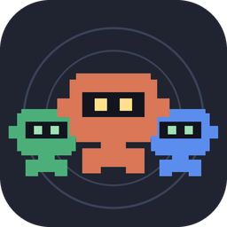
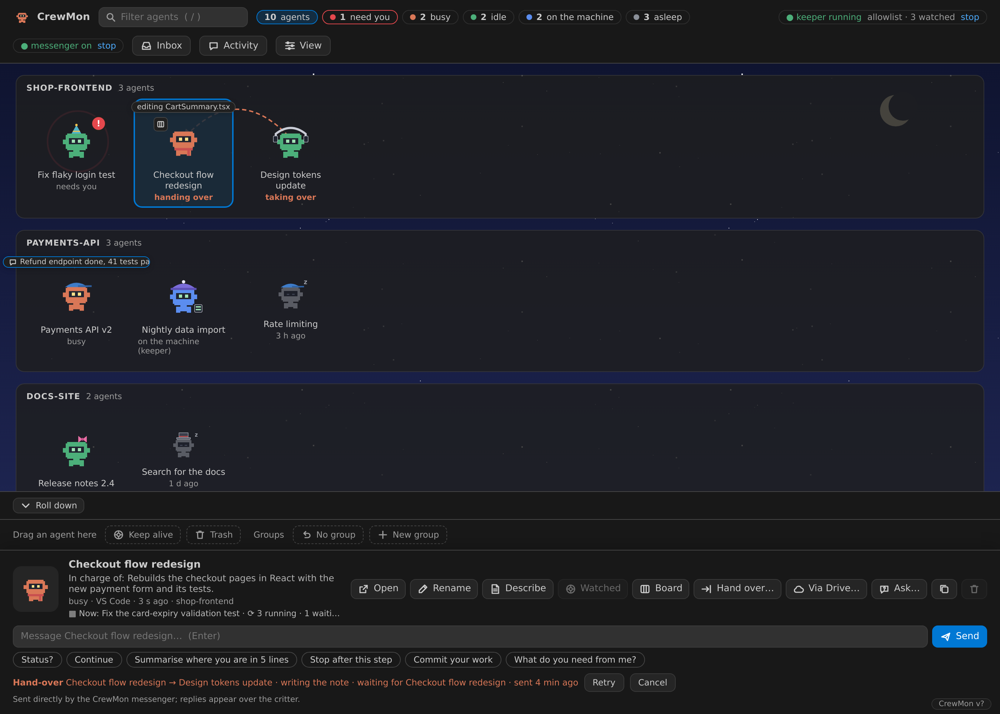
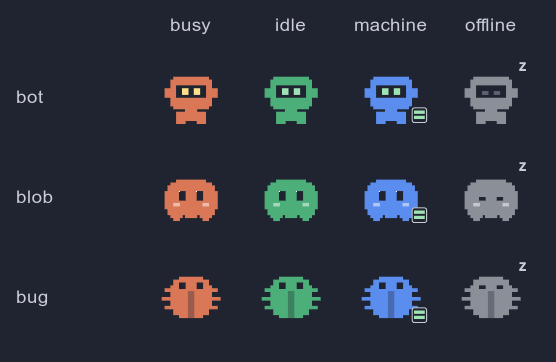
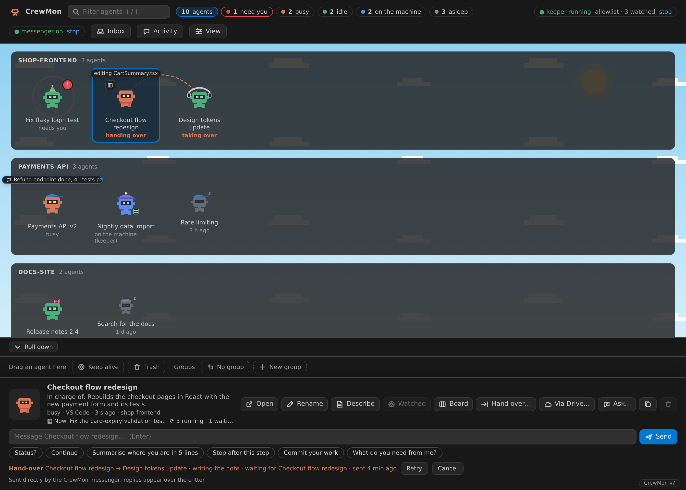
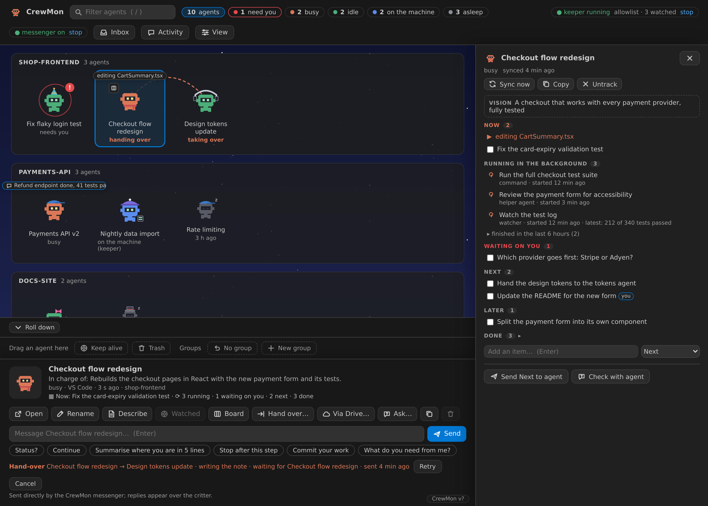
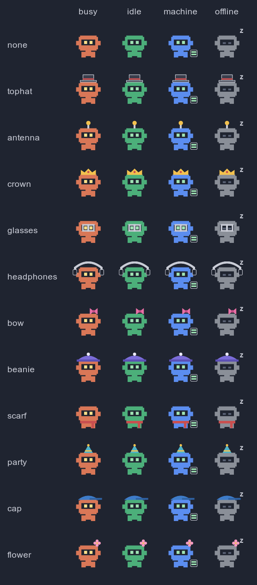

<p align="center"></p>

<h1 align="center">CrewMon</h1>
<p align="center"><b>Crew Monitor for your Claude Code agents, inside VS Code.</b><br>
See every agent at a glance, know what each one is doing, and talk to them, all from one map.</p>

---

When you run several Claude Code chats at once, it gets hard to keep track of which one is working on what, which
are still running, and which you left days ago. CrewMon turns them into a small crew of critters on one map.

<p align="center"></p>

## Features

- **🗺️ Live map**: one critter per agent (a **Bot**, **Blob** or **Bug**, your choice), grouped by project or by
  your own groups. Each keeps its own accessory (hat, crown, headphones, …), and its colour shows the state: **orange** busy, **green** idle in VS Code, **blue** running on the machine,
  **grey** asleep.
- **💭 What it's doing**: busy agents show a speech bubble (*editing extension.js*, *running tests*).
- **❗ Needs you**: a red badge when an agent is waiting for your answer or approval.
- **🧾 In charge of**: hover for a one-line description of each agent's job, written by AI from its own summary,
  or by you.
- **▦ Work boards**: *Track* an agent and CrewMon keeps a board of its work, drawn from its chat:
  **Now · Waiting on you · Next · Later · Done**, plus your **Vision** line. You add, tick, pin and move items; the
  agent never has to keep it.
- **💬 Message from the map**: select an agent, type, press Enter, or click a quick chip (*Status?*, *Continue*,
  *Summarise where you are*). Select several to message them all.
- **🤝 Agent to agent**: drag one critter onto another to **hand over** work, **ask** a question, or let them
  **talk** for a few turns.
- **🛟 Keep alive**: the keeper keeps an agent running on the machine when VS Code closes it, so you can keep using
  it from the Claude app on your phone.
- **✏️ Organise**: rename agents, put them in groups, arrange them freely, delete old ones (to a trash you can
  restore from).
- **🎨 Make it yours**: in **View**, pick the critter (Bot, Blob or Bug) and the scene (Night city, Space station,
  Meadow, Starfield, Blueprint, Dots, Plain).

<p align="center">
&nbsp;&nbsp;</p>

## Install

### Requirements
- **VS Code** 1.85 or newer with the **Claude Code** extension, signed in.
- **Linux** (also over Remote-SSH) or **macOS**. Windows should show the map and the live state, but is untested.
- The **keeper** and the **messenger** need tmux, so Linux or macOS (`brew install tmux`).
- **Python 3**, to build the package and for the keeper.

### 1. Get the package
Either use a ready `crewmon-<version>.vsix`, or build it from this repository:
```bash
git clone <this repository> CrewMon
cd CrewMon
python3 build_vsix.py           # -> dist/crewmon-<version>.vsix
```
No Node or npm is needed: the build uses only Python's standard library.

### 2. Install it in VS Code
- **Extensions** view (`Ctrl+Shift+X`) → **⋯** → **Install from VSIX…** → pick the `.vsix`.
- Or from a terminal: `code --install-extension dist/crewmon-<version>.vsix`
- **Working over SSH (Remote-SSH)?** Install it while connected; it runs on the remote machine, where your agents are.
  From a terminal on that machine you can also use
  `~/.vscode-server/cli/servers/<version>/server/bin/code-server --install-extension <absolute path to the .vsix>`.

Then run **Developer: Reload Window** once. Reloading restarts the Claude chats in VS Code, so do it when none is in
the middle of a task.

### 3. Optional: the keeper command
To use the keeper from a terminal as well, put it on your PATH:
```bash
ln -s "$PWD/keeper/keeper" ~/.local/bin/keeper
```

## Quick start

1. Press **Ctrl+Alt+A**, click **Crew** in the status bar, or run **CrewMon: Open** from the command palette.
2. **Hover** a critter to see what it is in charge of. **Click** it to select it. **Double-click** opens the chat.
3. With a critter selected, use the panel at the bottom: type a message and press **Enter**, or click a chip.
4. **Drag** a critter onto another one for *Hand over*, *Ask* or *Let them talk*. Drag it onto the dock at the bottom
   for *Keep alive*, *Trash* or a group.
5. Press **?** for the keyboard shortcuts.

## Using CrewMon

### The map
| You see | It means |
|---|---|
| 🟠 orange critter, hopping | busy right now; the bubble says what it is doing |
| 🟢 green | open in VS Code, idle |
| 🔵 blue, with a server badge | running on the machine (kept alive by the keeper) |
| ⚪ grey, asleep | not running; double-click to wake it in VS Code |
| ❗ red badge | waiting for you: a question, or most likely an approval |
| bigger critter | active more recently |

The top bar has the filter (`/`), *running only*, the layout switch (*Grouped* / *Free*), the background, and the
status of the keeper and the messenger.

### The panel (click a critter)
**Open** · **Rename** · **Describe** · **Keep alive** · **Hand over…** · **Ask…** · copy id · delete, then the
**message bar** with the **quick chips**. Shift- or Ctrl-click to select several agents; the message goes to all of
them.

The dock, card and message bar start **rolled down** to one slim line. **Roll up** (or **B**) opens them, **M** opens them
to type a message, and dragging an agent shows the dock anyway. CrewMon remembers how you left it.

### Work boards
Click **Track** on an agent's card (or press **T**, or right-click → *Track*). A board icon appears on its critter,
the card shows one line (*Now: … · 1 waiting on you · 2 next*), and **Board** opens the drawer:

<p align="center"></p>

- **The agent works the way it wants.** It is never told about the board. When it goes idle after new turns, a small
  model (Haiku) reads what happened and proposes changes; CrewMon applies them under fixed rules. If the agent keeps
  its own to-do list, that list is used as is.
- **Your items stay yours**: what you add, edit or pin is never reworded or moved by the sync; it can only be ticked
  done. What you delete never comes back. *Done* without proof shows as *probably*.
- **Running in the background**: the commands, helper agents, workflows and watchers it started, with how long they
  have run (⟳), and what finished in the last 6 hours (✓ done, ✗ failed, ■ stopped). Read straight from the chat, no AI.
- **Talk to the agent from it**: *Send Next to agent* and *Check with agent* send at once, and its reply shows under
  the buttons; the board then updates itself. *Ask* on an item fills the message bar for you to finish.
  **Sync now**, **Copy** (as Markdown) and **Untrack** (the board is kept) are at the top.
- Design and rules: [docs/BOARD.md](docs/BOARD.md).

### Drag and drop
- **Onto another critter** (or use **Hand over…** / **Ask…** in the agent card, or the right-click menu, and pick
  the other agent from a list):
  - **Hand over to it**: first a preview window shows **both instructions, editable**, with an optional *What should be
    handed over?* field. A then writes a hand-over note (goal, what's done, decisions, where things are, open problems,
    next steps). With *Let me read the note before it continues* (on by default), you get **Read the note** and
    **Send to B** before B is told anything. Notes are kept in `~/.claude/crewmon/handovers/`.
  - **Ask it a question**: B answers; the answer goes to you and to A.
  - **Let them talk about…**: A and B discuss a topic for 1–4 turns each, then A sends you a summary.
- **Onto the dock**: 🛟 *Keep alive* · 🗑 *Trash* · 📁 a group · *＋ New group* · *↩ No group*.
- **In the Free layout**: drag a critter anywhere; CrewMon remembers where.

### Keyboard
`←` `→` `↑` `↓` move · `Enter` open · `M` message · `R` rename · `D` description · `K` keep alive · `Del` trash ·
`/` filter · `Esc` clear · `?` help

## The messenger: talking to agents directly

Without the messenger, CrewMon sends a message by opening the chat with your text typed in, and you press Enter there.
**With the messenger, CrewMon delivers the message itself and shows the reply on the map** (a 💬 bubble and a
notification). *Ask* and *Talk* need it.

The messenger is a background Claude Code session (tmux `crewmon-messenger`) running a small add-on that uses Claude
Code's built-in session-to-session messaging. It only passes messages along: its own AI never runs, so it costs nothing
by itself. Each message is a normal turn for the agent that receives it.

**Turn it on:** click **start** next to *messenger* in the top bar. The first time, Claude asks whether to trust the
messenger's folder (`~/.claude/crewmon/messenger`). Run `tmux attach -t crewmon-messenger`, choose
*Yes, I trust this folder*, then press `Ctrl+b` `d` to leave it running. It shows **● messenger on** when ready.

**Activity** (top bar) lists every conversation in progress, with **Retry** and **Cancel**, and every message and
reply (click one for the full text). If an agent restarts before it answers (a VS Code reload, the keeper handing it
back), CrewMon sends its request again by itself.

**Look inside:** `tmux attach -t crewmon-messenger` shows its screen. `~/.claude/crewmon/messenger/inbox.jsonl` lists
what was delivered and every reply (`tail -f` it to watch live).

Claude Code delivers a message from another session straight away only when both use the same kind of permission
mode; otherwise it holds the message for your approval in that chat.

## Hand-overs through Google Drive

Hand work over to an agent that is not on this machine: another computer, a colleague's Claude, a claude.ai or Claude
app chat. It needs the messenger, and uses the Google Drive connector of your Claude account (nothing else to sign in).

1. **Send**: agent card → **Via Drive…** (or right-click → *Hand over via Google Drive…*, or choose *Someone else,
   through Google Drive* in the hand-over window). The agent writes its note; you get **Read the note** and **Upload to
   Google Drive**. Before uploading, CrewMon checks the note for participant ids, study codes, local paths, email and IP
   addresses and secrets, and asks again if it finds any. The note becomes a Google Doc in the folder
   **CrewMon hand-overs** (created the first time), and you get its link and a **pickup message** to paste anywhere.
   **Files** can go with it: choose *Attach files or folders…*, and CrewMon zips them (up to 20 MB) next to the note as
   `<note title> (files).zip`, after showing you every file. Data files (`.parquet`, `.csv`, `.pkl`, `.h5`, …), secrets
   (`.env`, keys), links, `.git`, `node_modules` and caches are always left out.
2. **Pick up**: the **Inbox** (top bar) lists the hand-overs in that folder. **Start with…** gives one to a running agent
   here: CrewMon downloads it (and unzips its files into `handovers/drive-<id>-files/`), tells the agent to continue,
   and marks the Doc "Picked up by …". A zip you put in the folder yourself shows up too: **Unzip for…** unpacks it for
   an agent here. **Open** and **Pickup message** are there too.

The folder is private to your Drive until you share it. Turn Drive hand-overs off for projects with sensitive data with
`crewmon.driveBlockedFolders` (parts of a folder path, e.g. `["AI_PROG_PD_risk_modeling"]`).

## The keeper: agents that stay alive

`keeper` keeps chats usable from the Claude app when VS Code closes them. When a watched chat stops running in VS Code,
the keeper resumes it on the machine in tmux with Remote Control on. When you reopen it in VS Code, the keeper hands it
back.

- In CrewMon: **🛟 Keep alive** (or drag onto 🛟). Its state is shown in the top bar and on each hover card.
- In a terminal: `keeper start | stop | status | watch <id> | hold <id> | end <id> | delete <id> | restore <id> | purge`.
- It starts in **allowlist** mode: it manages only the chats you mark. `keeper mode all` manages every chat seen in
  VS Code.

## Settings

| Setting | Default | |
|---|---|---|
| `crewmon.days` | 7 | show agents active in the last N days |
| `crewmon.refreshSeconds` | 5 | how often the map refreshes |
| `crewmon.aiDescriptions` | true | write the one-line *In charge of* with a small model (Haiku), once per summary |
| `crewmon.boardSync` | true | keep tracked agents' boards up to date with Haiku when they go idle after new turns |
| `crewmon.quickMessages` | 6 chips | the one-click messages under the message bar |
| `crewmon.driveBlockedFolders` | `[]` | folders whose agents may not hand over through Google Drive |
| `crewmon.critter` | `bot` | how agents are drawn: `bot`, `blob` or `bug` (also in the top bar) |

## Privacy and safety

- CrewMon runs **only on your machine**. It reads your Claude Code chat files (`~/.claude/projects`) and the process
  list, and keeps its own small files in `~/.claude/crewmon/` (your descriptions, groups, the messenger's in/outbox).
- It **never changes a chat**, with one exception: *Rename* on a chat that is not running adds the same title line that
  Claude Code's own rename writes.
- **Delete** asks first, refuses while the chat is open in VS Code, and moves the files to the keeper's trash
  (`keeper restore <id>` brings them back; `keeper purge` empties it for good).
- AI descriptions are made with your own Claude login (`claude -p --model haiku`, no tools, nothing saved as a chat).
  Turn them off with `crewmon.aiDescriptions`. Work boards use the same way, only for agents you track, and only
  when they have new turns; `crewmon.boardSync` turns that off. Boards are kept in `~/.claude/crewmon/boards/`.
- Messages sent through CrewMon are normal messages to your agents. They act on them with the permissions those chats
  already have.

## Troubleshooting

| Problem | Fix |
|---|---|
| The map is empty or the command is missing after an update | **Developer: Reload Window** |
| "keeper not found" | reload the window; check `keeper status` in a terminal |
| Messenger stays on "starting…" | `tmux attach -t crewmon-messenger` and accept the folder-trust question |
| A message was not delivered | look at `~/.claude/crewmon/messenger/inbox.jsonl` for an `error` line |
| Rename did nothing | for a chat open in VS Code, CrewMon opens Claude's own *Rename* box; type the name there |
| No live state (all grey) | Linux: CrewMon needs `/proc`. macOS and Windows: check that `~/.claude/sessions` has a file per running chat |
| "tmux is not installed" | macOS: `brew install tmux`; Linux: your package manager |

## Development

```
package.json        extension manifest (command, Ctrl+Alt+A, settings)
extension.js        the VS Code side: the tab, refresh, actions, keeper, messenger, AI descriptions
processes.js        which chats are running (Linux: /proc; macOS: ps + Claude Code's session files; Windows: session files)
snapshot.js         reads the sessions (node snapshot.js prints them in a terminal)
media/map.html      the map
media/critters.js   the critters: three styles, 11 accessories, a pose per state
keeper/keeper       the keeper (Python; state, log and trash in ~/.claude/keeper/)
messenger/          the messenger add-on (runs in the background session)
build_vsix.py       builds dist/crewmon-<version>.vsix
make_icon.py        draws media/icon.png (needs Pillow)
tools/screenshot/   the README screenshots: made-up example agents on the real map page, taken with headless Chromium
tools/gallery.js    draws the preview sheets: node tools/gallery.js bot > docs/critters.svg, … styles > docs/styles.svg
```
Edit, run `python3 build_vsix.py`, install the new `.vsix`, and reload the window.

**Before every push**, `tools/check.sh` must pass: the code parses, the messenger validates, the package builds and
`vsce` accepts it, the map opens in a headless browser with no page errors, and nothing personal (home paths, user and
host names, the machine's IP, emails, keys) or generated (data files, `dist/`, `node_modules/`) goes up.
`tools/install-hooks.sh` installs it as a git pre-push hook, so `git push` refuses to push when it fails.

All 11 accessories on the default Bot, in every state:

<p align="center"></p>

## License

MIT, see [LICENSE](LICENSE). Copyright (c) 2026 tolism.

CrewMon is an independent tool, not made by or affiliated with Anthropic. "Claude" and "Claude Code" are trademarks of
Anthropic. The critters and the logo are CrewMon's own designs.
